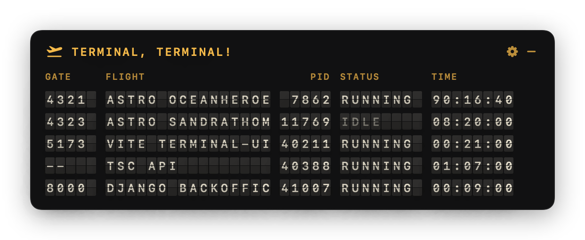

# Terminal, Terminal!

A floating split-flap departure board for macOS that shows your running dev servers and forgotten background tasks as flights.



- **GATE**: listening port, or `--` for a background task with no port
- **FLIGHT**: what's running (the "airline") and which project (the destination)
- **STATUS**: BOARDING, RUNNING, IDLE (near-zero CPU for a minute), DEPARTED
- **TIME**: uptime as hours, minutes and seconds

## Install

Runs on macOS 13 or later, on Apple silicon and Intel.

1. Download `TerminalTerminal-<version>.zip` from the latest GitHub release and unzip it.
2. Move **Terminal Terminal** to Applications and open it.
3. The app isn't notarised by Apple, so macOS blocks the first launch. Open **System Settings → Privacy & Security**, scroll down and click **Open Anyway**. Or run:

   ```sh
   xattr -dr com.apple.quarantine "/Applications/Terminal Terminal.app"
   ```

It has no Dock icon: look for the plane in the menu bar.

## Build from source

Needs Xcode 26 or later to build (the Liquid Glass settings use the macOS 26 SDK); the app still runs on macOS 13. No dependencies.

```sh
open Package.swift                 # in Xcode, then Run (⌘R)
swift run                          # or from the terminal
./scripts/bundle.sh                # or build a universal "build/Terminal Terminal.app"
```

## Use it

- **Click the menu bar plane** to show or hide the board.
- **⌘-click or right-click it**, or click the gear on the board, for settings: board style, display (flap, LED, pixel, plain), accent colour, seconds, refresh interval, show all ports, appear on new server, reset the board position, quit. Picking a style resets display and accent to that style's own.
- **Drag the board** anywhere. It remembers where you put it.
- **Hover a web server's GATE or FLIGHT and click** to open it in your browser. Recognised dev servers (Vite, Next, Astro, Django, …) flip their port to OPEN; databases and plain interpreters don't.
- **Hover a row and click ×** to send SIGTERM. If the process is still alive after 3 seconds, the row turns DELAYED and asks before sending SIGKILL.

The board appears on its own when the first server starts, and stays until you hide it with the menu bar plane or the – button on the board. Turn on **Appear on new server** in settings to bring it back whenever another server starts, even after hiding it.

## Permissions

None to grant. `lsof` and `ps` can read your own processes without Full Disk Access, Accessibility or Screen Recording.

- Only your own processes are shown. Root and other users' processes need `sudo` to see, and the app never asks for it.
- Signals only reach your own processes. Anything else shows DENIED.
- The app is not sandboxed, because a sandboxed app can't run `lsof`. That rules out the Mac App Store.

## What shows up

By default:

- **Port owners**: processes listening on TCP ports 1024 and above.
- **Background tasks**: recognised dev tools (watchers, builds, interpreters) with no port that have run for 5 minutes or more.

Hidden as noise:

- Apps and anything in a system directory (ControlCenter, Spotify, Figma helpers), unless a label rule recognises it (Ollama, Postgres.app, Docker).
- Processes started by a GUI app rather than a terminal, like Raycast extensions or editor language servers.
- MCP servers run by AI tools.
- Wrappers: `npm run dev` shows once, as the server it starts.

**Show all ports** in settings turns off the noise filter for port owners.

## Extending the labels

Rules live in `Sources/TerminalTerminal/Scanner/LabelHeuristics.swift`. Add a `LabelRule` to `rules`:

```swift
LabelRule("SANITY", .token("sanity")),             // a word in the command, by basename
LabelRule("DJANGO", web: true, .phrase("runserver")),  // a substring of the command line
LabelRule("JUPYTER", web: true, .tokenPrefix("jupyter")),  // jupyter, jupyter-lab, …
```

The first match wins, so put frameworks above the interpreters that run them. A matching rule also makes a portless process count as a background task. `web: true` marks a server whose port serves a page: hovering its GATE or FLIGHT flips GATE to OPEN, and clicking there opens `http://localhost:<port>`. To hide something, add it to `hiddenExecutables` or `hiddenTokenFragments` in the same file.

To check what the board would show without opening it:

```sh
swift run TerminalTerminal --scan          # add --all to bypass the noise filter
swift run TerminalTerminal --snapshot board.png
```

## Releasing

1. Bump `CFBundleShortVersionString` (and `CFBundleVersion`) in `Support/Info.plist`.
2. Run `./scripts/release.sh` to build the universal app and package `build/TerminalTerminal-<version>.zip` (about 700 KB).
3. Run `./scripts/release.sh --publish` to also create a draft GitHub release `v<version>` with the zip and install notes attached. Needs the `gh` CLI and a GitHub remote. Review the draft on GitHub, then publish it.
